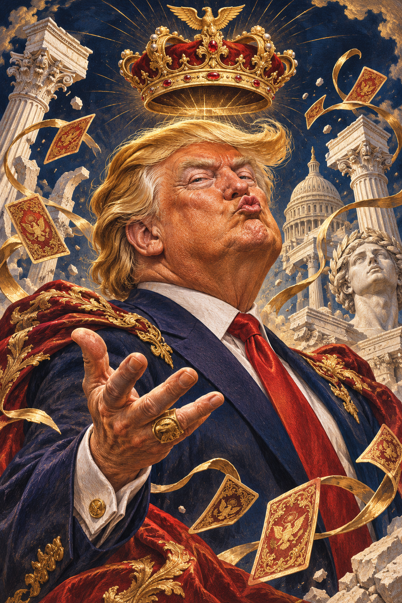

# Top Trumps — artwork and visual specification

2 November 2026

## Committed original asset

- File: `assets/artwork/donald-portrait.png`
- Format/dimensions: PNG, 1024 × 1536 pixels, 3,710,897 bytes.
- SHA-256: `8b402ef97ef55013f64615b46a9fc6144153a8859405f97abf15ae4cb142d76e`
- Git blob: `c296b93bc71959c9667c3f8c8487b37816ce6545`
- Origin: original AI-generated illustration created for this project on 2 November 2026. This is the exact raster used by the playable prototype, not a screenshot or an external hotlink.
- Alt text: Original satirical illustration of Donald Trump with a floating crown, gold playing cards and classical architecture.
- Current use: the same decorative portrait on each quote front. It must not vary according to category strength or provide a score hint. Separate per-quote illustrations have not been created.
- Runtime mapping: the reference UI requests `/trump-art.png`; copy this file to the independent application's `public/trump-art.png`, or update that URL.

## Art brief for future matching assets

Vertical collectible political satire illustration. Recognizable Donald Trump caricature with exaggerated pursed lips and sweeping golden hair, navy suit and red tie, theatrical imperious expression, ornate floating gold crown, gilded playing cards and classical architectural fragments. Engraved editorial illustration meets hand-painted luxury tarot. Midnight navy, antique gold, ivory and vermilion, warm dramatic light, fine detail. No embedded text, letters or card border; render readable quote text and the frame in the UI.

## Card construction

| Layer | Current design |
|---|---|
| Baize | Deep green felt `#104c3e`, subtle texture, dark wood rim and gold edge |
| Front | Ivory `#efe3c9`, fine gold double frame `#cda75d`, neutral A/B and card number, portrait, full quote, attribution, Flip action |
| Reverse | Midnight blue `#102531`, gold headings and frame, six full-width sin/score rows |
| House cover | Navy patterned back, crown, Top Trumps / The House wordmark, manual Flip computer's card action |
| Deciding row | Antique gold `#d3b172` with dark text on both reversed cards |
| Typography | Cormorant Garamond for editorial headings/quotes; DM Sans for UI. Provide Georgia/Arial fallbacks or self-host licensed font files |
| Geometry | Equal 640px card-shell height; desktop paired columns, mobile stacked; scroll long quotes inside the fixed front |

The quote text, gold frame, reverse, house cover and baize are code-rendered UI, not additional raster files. Their full source styles and markup are committed under `reference/prototype/app/`. Keep UI text separate from imagery so long quotes stay readable.

The earlier three-phone WhatsApp concept board is a visual inspiration from an earlier stage, not an implemented WhatsApp interface. This handoff's committed PNG and code-rendered cards are the current web design. WhatsApp delivery remains deferred.
