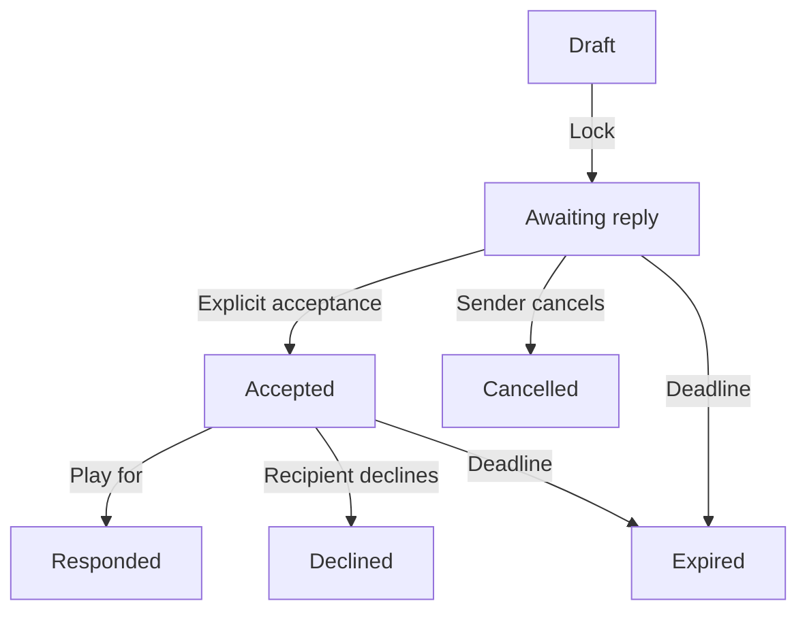

# Asynchronous friend challenges — developer implementation handoff

Version 1.0 · 2 November 2026 · **Specification only; not implemented**

This document is the canonical experience, process and solution for adding human challenges to the current AWS web game. The owner explicitly wants to send a card and let another person respond later. Nobody has to remain online. WhatsApp, SMS/iMessage, email and copied links are delivery channels for the same saved challenge; gameplay stays in the browser.

This supersedes any suggestion of a live two-person room or playing inside WhatsApp for this feature. Computer play remains available and retains its existing rules. Broader historic commerce, accounts and WhatsApp bot requirements are not prerequisites.

## 1. Agreed scope and proposed defaults

| Decision | Baseline |
|---|---|
| Agreed | Send a card challenge, close the browser, receive a response later. |
| Agreed | Share from the mobile browser through the phone's sharing panel; WhatsApp and Messages/SMS are supported destinations when available on that device. |
| Agreed | No Brevo subscription or automated WhatsApp/SMS gateway is required for this flow. The user chooses the recipient and confirms Send. |
| Agreed | Keep the illustrated card fronts, tap-to-flip reverses, coloured sin symbols, readable scores, green winning row and short win/loss effects. |
| Proposed v1 | Guest names and private access links; no account registration, contact import, phone-number collection or verified identity. |
| Proposed v1 | One server-dealt card for each human on every viewport, with no reroll within a challenge. Desktop computer play remains unchanged. |
| Proposed v1 | Sender chooses any of the six sins. Recipient sees the chosen sin mixed with one decoy, without scores or an indication of which is locked. |
| Proposed v1 | Unanswered challenges expire seven days after locking; completed results remain available for 30 days. A guest identity expires after 30 days of inactivity. |
| Deferred | Automatic reminders, delivery receipts, push notifications, friend directory, accounts, paid decks, public rankings and multi-person games. |

Proposed defaults fill implementation gaps; they are not claims that the owner separately approved each retention duration or rule detail. Make durations configurable and record changes here before release.

## 2. Sender experience

1. On the existing home page offer **Play computer**, **Send a challenge** and **My challenges**. Preserve the current computer experience behind its own entry.
2. Sender enters a short display name if needed. Explain that their name is a nickname, not a verified identity.
3. Server creates a draft, deals the sender's card and reserves a distinct recipient card. Save immutable content/score snapshots immediately. The sender sees only their own card.
4. Sender reads the full quote, taps the card/corner to inspect all six coloured sin rows and chooses a sin. Show the selection and **Lock challenge** before producing a shareable invitation. Draft inspection does not publish a challenge.
5. Lock atomically fixes both cards, the chosen sin and the hint pair. Show **Ready to share**, the expiry date, **Share invitation** and **Copy link**. The sender can now leave the site.
6. A separate tap on Share invitation invokes the native sharing panel with prepared text and the invitation URL. The sender chooses WhatsApp, Messages, email or another installed destination, selects the friend and confirms Send.
7. My challenges shows the challenge as **Awaiting reply**, with Share again and Cancel available. Do not assert that the message was sent, delivered or read: sharing is outside the game's control.

Suggested invitation text: “Danny sent you a Top Trumps challenge. Play whenever you're ready: [invitation URL]”. Include no locked sin, hidden scores, recipient card or private recovery credential in the text or preview.

## 3. Recipient experience

1. Friend opens the link hours or days later. The landing page explains the challenge, sender nickname and expiry after validating the invitation. A GET or link preview must not accept it or assign a player seat.
2. Friend enters a nickname and explicitly taps **Accept challenge**. Server atomically assigns the one recipient seat to their guest identity and returns their previously reserved card. The first successful acceptance wins; forwarding the link does not create extra players.
3. Recipient reads their quote and can freely flip to all six of their own scores. The sender's card, scores and exact sin remain hidden before response.
4. Show the existing **Play for** control with the two possible coloured sin badges and **One locked**. The two badges are one action, not separate choices of category. Label the opponent with the sender's nickname, not Computer.
5. Tapping Play for commits the recipient's card against the sender's locked sin. Save the result once. Return the sender's illustrated quote front on top of the recipient card, slightly offset. Keep scores and outcome behind the explicit reveal interaction.
6. Recipient flips the opponent card. Spread both full-size cards with overlap; the local player's left card starts in front so both score columns can be read. Show green only on the winning sin of the winning card; mark the played sin on the other. A draw marks both as Draw. Reuse the short celebration and reduced-motion behaviour.
7. Offer **Challenge back**, **Share reply**, and **My challenges**. Challenge back creates a fresh draft with this person as sender; it does not modify the finished challenge. Sharing that new invitation is still a user action.

Declining or leaving before commitment is not a loss. Returning in the same browser resumes the claimed challenge with the same card and hints; accepting or inspecting again never rerolls.

## 4. Sender's return and notification limits

The sender reopens My challenges or their saved challenge page. After a response, show **Result ready** without revealing the outcome or changing the displayed tally early. Let the sender read the opponent quote and flip it to see scores, winner and celebration. Both people eventually see the same immutable result, expressed from their own perspective.

There are no automatic WhatsApp/SMS messages when the sender's browser is closed. The recipient may tap Share reply and send: “I've played your Top Trumps challenge. Your result is ready: [challenge page URL]”. This notification link contains no guest recovery token and only grants a participant access through their existing session. The sender can also check My challenges without receiving a reply message.

My challenges has **Sent**, **Received** and **Completed** views; status labels include Draft, Ready/Awaiting reply, Accepted, Result ready, Completed, Declined, Cancelled and Expired. Result-ready entries do not disclose the opponent score/outcome before that viewer's reveal. Display actual expiry dates. A local Archive action may hide an entry for that guest without removing the other person's result.

Refresh a visible waiting page on focus/resume and with modest polling while visible, for example every 10 seconds with backoff. Stop polling when hidden or terminal. There is no live-room, persistent socket or background-delivery dependency in v1.

## 5. Human challenge rules and disclosure

- Draw two distinct eligible cards using the existing server-side eligibility policy, secure random selection and snapshot format. Reject creation if fewer than two eligible cards are available. Do not introduce HOLD cards or imply that draft editorial content has been independently verified.
- Lock the sender card, reserved recipient card, content/rules version, chosen sin and hints before the invitation becomes usable. Neither party, device type, repeated opening nor later editorial updates may change them.
- Sender may choose any configured sin, matching the existing Deal-first choice. Proposed decoy: the strongest *other* sin on the sender's card, breaking ties with canonical deck category order. Present the chosen sin and decoy in canonical order, never choice/rank order.
- Therefore human hints are **two possibilities**, not “top two sins”. This distinction is deliberate: an arbitrary sender-selected sin need not rank in their top two. Do not silently restrict choices or alter computer Deal-second's current random top-two rule.
- Recipient chooses whether to play their dealt card; they do not choose the category. Ignore or reject a client-supplied category on the response endpoint.
- Higher selected-sin score wins; equality draws. Use the server result for all highlights, effects and totals. Never calculate another outcome in the share/UI layer.

| Stage/viewer | Own card and six scores | Other card | Exact locked sin | Other scores/result |
|---|---|---|---|---|
| Sender draft/locked/waiting | Available | Absent | Known to sender | Absent |
| Valid invite before acceptance | Absent | Absent | Absent | Absent |
| Accepted recipient, before play | Available | Absent | Only two possible names | Absent |
| After response, before viewer reveal | Available | Quote-front projection only | Still hidden from recipient | Absent |
| After that viewer's explicit reveal | Available | Full snapshot and sources | Available | Available |
| Anonymous public page/link preview | Absent | Absent | Absent | Absent |

The sender already knows the sin they chose; never imply otherwise. Per-viewer reveal controls disclosure and celebration; it does not recalculate or change the result. Once either participant has seen the result, sharing information outside the game cannot be prevented.

## 6. State and transitions



Store a canonical result as `{category, senderScore, recipientScore, winnerRole: "sender" | "recipient" | null}`. Role-aware projections return `yours`, `theirs` and a stable win/loss/draw code for that viewer; do not save one person's “You win” wording as the other person's outcome. Translate names in presentation without repeating score comparison logic.

Persist separate `senderRevealedAt` and `recipientRevealedAt` values on Responded. These allow independent viewing later. Completed in the UI means this viewer has revealed; the underlying result is already fixed at Responded.

Drafts may be discarded. Sender cancellation is permitted before Responded, including after acceptance; response-versus-cancel races must have exactly one winner. No cancellation, decline or expiry may overwrite a responded result. Enforce deadlines in application checks, not by waiting for DynamoDB TTL deletion. Accepted challenges retain the original lock deadline, rather than gaining unlimited time by reopening.

All mutation requests require a guest session, role checks, an idempotency key and expected version where appropriate. A retry returns the original committed choice/current authorised view. Reusing a key with different parameters is a conflict. Authorise before resolving an idempotent replay; a token/key must not bypass ownership.

## 7. Sharing implementation

Create/lock the challenge **before** offering Share invitation. `navigator.share()` needs a fresh user gesture, so do not put a slow create request between the Share tap and the native share call. Use two explicit steps: lock/save, then Share.

```js
// inviteUrl was already prepared for this authorised sender.
async function shareInvitation() {
  const data = {
    title: 'Top Trumps challenge',
    text: 'Play my Top Trumps challenge whenever you are ready.',
    url: inviteUrl,
  };
  if (navigator.share) {
    try { await navigator.share(data); }
    catch (error) {
      if (error.name !== 'AbortError') showCopyLinkFallback();
    }
  } else showCopyLinkFallback();
}
```

This is a contract sketch, not shipped code. Feature-detect on HTTPS; preserve a selectable-link fallback if clipboard access fails. Closing the share panel leaves the saved challenge available for Share again. Successful resolution of the share promise is not proof of message delivery or acceptance.

The OS chooses installed destinations and whether WhatsApp/Messages opens an extension or its full app. Do not promise silent sending, preselected contacts, universal WhatsApp availability, or staying entirely inside Safari. No phone/address-book permissions are needed. Ordinary SMS/mobile-data plan charges and AWS hosting/storage charges can still apply; no messaging-provider subscription is needed for this user-confirmed link sharing.

## 8. Identity, links and privacy

Use a new challenge guest identity rather than the current 24-hour `tt_session` computer-round cookie. Proposed `tt_guest` is an opaque random 256-bit credential, HttpOnly, Secure on HTTPS, SameSite=Lax. Store its hash-to-guest mapping server-side; nicknames are not authorisation. Refresh authenticated guest retention on meaningful activity, with a disclosed 30-day inactivity limit.

Invitation shape: `/challenge/<public-id>#invite=<capability>`. Public IDs must be unpredictable. The fragment carries a role-limited invitation capability and is submitted only in the explicit Accept POST. A generic public page/preview must never consume it, reveal snapshots or run an automatic acceptance mutation.

Concrete token baseline: derive purpose-separated HMAC-SHA256 capabilities from a server-only random signing secret, the challenge/guest ID and a stored generation. Invitation capability purpose is `invite`; private guest recovery purpose is `guest-recovery`. Validate with constant-time comparison, application expiry and current generation/claim state. The owner can regenerate the same invitation for Share again without storing a plaintext invite secret. Explicit cancellation/revocation invalidates it. First claim binds the recipient role; the same guest can resume, another guest gets Already accepted without private data.

Offer each guest an optional **Save private access link** to recover their own challenges on another browser. It is a bearer credential intentionally restoring their guest history/totals, not a public invitation. Warn briefly to keep it private. A recovery link may use `/challenges#access=<guest-id>.<capability>` and, after explicit confirmation, mint a new guest cookie without silently merging another identity. Never include this link in Share invitation or Share reply. Without the original browser session or private recovery link, accountless history cannot be reliably recovered.

WhatsApp/in-app browsers may use a different cookie context from Safari. Test this explicitly; provide Open in browser and private-access recovery guidance rather than promising universal cross-browser continuity. The original claimed invitation must not let a different device take over the recipient seat just because it has been forwarded.

Use no-referrer/no-store responses on private routes; strip exchanged fragments from the address bar, exclude these pages from indexing and third-party analytics, and redact capabilities from logs/errors. Preview metadata must contain no secret, nickname-specific content, cards, scores or result. Validate input sizes and nickname length; escape names as text. Rate-limit challenge creation, acceptance and recovery attempts. A forwarded unclaimed invitation grants its holder the one seat: make that clear in help.

## 9. AWS solution and records

Current runnable source is `web/` on Next.js/Amplify. Existing computer storage is one record per session in DynamoDB, with GetItem/PutItem permissions and a 24-hour round expiry. That record cannot be reused as the only challenge store: a person can have several pending challenges and two independent guests must address the same saved record.

Proposed implementation adds a dedicated on-demand, encrypted DynamoDB ChallengeTable with `pk` and `sk` string keys and `purgeAt` TTL. Keep the existing computer table and behaviour intact. This is a design choice, not provisioned infrastructure.

| Record keys | Purpose / important fields |
|---|---|
| `GUEST#id / META` | Nickname, recovery generation, activity/guest expiry and version. |
| `AUTH#credentialHash / META` | Credential-to-guest mapping and expiry; no plaintext cookie. |
| `GUEST#id / STATS` | Human-challenge wins, losses and draws for this guest. |
| `CHALLENGE#id / META` | Version/state, sender and claimed recipient guest IDs, snapshots, content/rules versions, locked sin, hints, token generation, timestamps, deadline, fixed result, per-viewer reveal timestamps. |
| `GUEST#id / CHALLENGE#createdAt#id` | Per-guest list reference/status; sender entry at draft creation, recipient entry at acceptance. Query these rather than scanning the table. |
| `CHALLENGE#id / AWARD#guestId` | Exactly-once tally marker created at that guest's first reveal. |
| `OP#guestId#requestId / META` | Action/parameter digest and committed challenge reference for idempotent retries. |

Update the challenge and affected list entries together with conditional DynamoDB transactions. Acceptance conditions check open state, valid deadline, invitation generation and an unclaimed recipient seat. Response conditions check recipient ownership, Accepted state, expected version and reserved card ID. Persist response and list updates in one atomic operation.

At each guest's first reveal, atomically set their reveal timestamp, create the unique award marker and increment that guest's human totals. This avoids leaking a win/loss through the header before the manual reveal. Repeated reveal/refresh cannot award another result. In challenge views label the tally **Friends: You / Opponents / Draws**; do not label a human Computer or merge server challenge totals into the existing browser-local computer tally. Verified accounts or a shared per-friend series leaderboard are future scope.

Retain completed records and award markers for the configured result period. Idempotency records must last at least as long as their challenge records, so a late retry cannot recreate an existing draft. Proposed cleanup for unanswered terminal challenges is seven days after their deadline, to allow an explanatory expired/cancelled page before removal. Expiry/cancellation/decline never award a win or loss. TTL is delayed cleanup: all reads/writes must enforce `deadline`, result retention and guest expiry even while rows still physically exist. Anonymous totals remain available with the guest identity; do not promise permanent account history.

Extend `infra/toptrumps-state.yaml` (or a separate explicit challenge stack) with the new table, outputs and least-privilege role permissions for required reads, writes, queries, batch reads and transactional underlying operations on that table. Add a server-only challenge-table configuration and provision the signing secret through the existing AWS account's secret-management facilities; never expose it as NEXT_PUBLIC or commit it to the repo/build artefacts. Any Secrets Manager read/KMS permissions must be restricted to the chosen secret/key. Update runtime configuration/deployment scripts deliberately; the current environment helper only knows the computer table and region.

Use the actual Amplify app/stack region. The owner's current deployment context is Stockholm (`eu-north-1`); do not blindly use historic London examples in older deployment notes. No resources, secrets or account settings are changed by this documentation commit.

## 10. Proposed API contract

All private endpoints are no-store. GETs are read-only, and all mutations check origin/CSRF protections, guest credentials, role, deadlines and body limits.

| Endpoint | Behaviour |
|---|---|
| `POST /api/challenges/draft` | Idempotently create one saved draft and both dealt snapshots. Return only sender card and draft metadata. |
| `POST /api/challenges/:id/lock` | Sender commits valid card/sin; freeze hints/deadline and open the invitation. |
| `GET /api/challenges/:id/invitation` | Authorised sender obtains shareable invitation URL. Does not change the deal. |
| `GET /api/challenges/:id/preview` | Generic public metadata only; never claims a seat or includes game secrets. |
| `POST /api/challenges/:id/inspect-invitation` | Read-only validation of a fragment invitation proof; return sender nickname, expiry and safe availability state, without claiming or revealing cards. Public SSR previews stay generic. |
| `POST /api/challenges/:id/accept` | Validate invitation proof and explicit nickname confirmation; atomically bind recipient and return their card/hints. |
| `GET /api/challenges/:id` | Role-aware projection; no opponent scores/result until this viewer reveals a Responded challenge. |
| `POST /api/challenges/:id/respond` | Recipient commits only their reserved card; ignore/reject category; atomically save the result once. Return opponent quote front, not scores. |
| `POST /api/challenges/:id/reveal` | Authorised participant reveals original result, receives full comparison and one tally award. |
| `POST /api/challenges/:id/cancel` | Sender cancels a non-responded challenge; version/race checks apply. |
| `POST /api/challenges/:id/decline` | Claimed recipient declines before response; no outcome award. |
| `GET /api/challenges` | Paginated private Sent/Received/Completed list and appropriate guest totals. Result-ready summaries conceal unrevealed outcomes. |
| `POST /api/guests/recover` | Exchange a valid private guest recovery proof after confirmation for a guest cookie. |

Return explicit Already accepted, Expired, Cancelled, Declined and Unavailable states with safe recovery actions. Use conflict responses for a lost race and return the current authorised state, never reroll automatically. Challenge back reuses the same draft creation service with a reference to the finished challenge; it does not introduce another deal/resolution implementation.

## 11. Code reuse and implementation sequence

1. Add tests for the human rules/disclosure and state transitions. Extract any necessary card-selection and comparison helpers from `web/lib/game.mjs` so computer and human paths call the **same** core rules; do not copy the scoring expression into another engine.
2. Add a challenge transition module and transactional service/store. Reuse immutable snapshot handling, source content and eligibility filters. Keep `web/lib/service.mjs`'s computer session flow separate from human challenge lifetimes.
3. Provision the challenge table, runtime settings and scoped secret access in an isolated development environment. Add real DynamoDB concurrency integration tests; in-memory tests alone do not validate transactional/IAM behaviour.
4. Extract reusable card presentation from the existing page once, rather than maintaining a second copied card UI. Reuse `SinBadge.tsx`, `RoundCelebration.tsx`, full portrait/quote layout, folded corners, left-card overlap and accessible green Winner markers. Extend the celebration component with an opponent display-name parameter: its current loss wording says Computer and must name the human opponent here, while preserving the computer default.
5. Implement Create/Lock/Share, claim/respond/reveal, My challenges, private recovery and Challenge back. Reuse one sharing utility for WhatsApp, Messages, email and copy fallback.
6. Add role-aware HTTP and two-browser end-to-end tests. Validate real iPhone Safari/WhatsApp/Messages behaviour and Android Chrome. Feature-detect sharing rather than assuming every desktop/mobile target exists.
7. Update deployment/configuration docs, enable the human entry only when its storage/secret configuration is healthy, deploy, and verify with two independent devices. A missing challenge configuration must not break existing computer play.

The current `game.mjs` is computer-oriented: calling its existing deal function unmodified would reserve a computer opponent and apply its top-two rule. Factor and reuse primitives instead of treating that API as a complete human challenge implementation. The historical `reference/prototype/` runtime is not a second implementation target.

## 12. Acceptance criteria

- Sender can save/share a challenge, close the site and reopen it the next day with the same card/sin. Recipient can respond with the sender offline.
- Native sharing offers available WhatsApp/Messages destinations; copied links work too. Cancelling sharing keeps the same saved invitation. No provider login, subscription, silent send or contact import is required.
- Link-preview GETs, browser prefetch, repeated opening and bots do not accept, consume, respond to or reveal a challenge.
- Two different guests racing to accept yield one recipient. A forwarded or already-used link exposes no other player's private card or result.
- Sender may choose a low-ranked sin; hints still contain that exact sin plus a distinct decoy, without identifying the chosen one. Computer top-two behaviour is unchanged.
- Payload/network tests at every stage prove the disclosure matrix. Shared text and metadata leak no opponent card, scores, locked sin or recovery credential.
- Duplicate create, lock, accept, respond, reveal and refresh requests preserve one deal, one immutable result and one tally award per participant. Reused keys with altered parameters fail.
- Response/cancel/expiry races have one terminal outcome; deadlines are enforced even with expired rows still present. Editorial deployments cannot change stored snapshots.
- Both participants see the same comparison from their own perspective; only the winning card's deciding row is green. Names and sin symbols replace Computer labels correctly. Draw, decline and expiry totals are correct.
- Sender return does not need a paid alert. Share reply opens the same challenge; private access recovery works across a separately tested browser context without granting a second recipient seat.
- Card text/artwork remain uncropped/readable; thin card dimensions do not shrink on reveal; tapping either side flips. Left local card initially overlays right; both numeric score columns stay inspectable. Controls and the Play for panel work at 320px and in landscape.
- Keyboard, screen-reader, long-quote and reduced-motion paths work. Celebrations clear automatically and do not repeat after restoring an already-viewed result.
- Missing sharing support, unavailable clipboard, lost network, expired cookie, invalid/revoked capability and unavailable challenge configuration have understandable recovery states. Logs contain no capabilities.
- All existing computer game/tally tests still pass, plus human transition, API secrecy, real database concurrency and two-device sharing tests. Record physical-device verification separately from desktop preview checks.

## 13. Source references and handoff status

Reviewed against the current repo at commit `b85fdd9bc5d0e432604fd2d17646716a33713f16`. Read [REQUIREMENTS.md](REQUIREMENTS.md), [SOLUTION_DESIGN.md](SOLUTION_DESIGN.md), [GAME_FLOWS.md](GAME_FLOWS.md) and [DEVELOPER_HANDOFF.md](DEVELOPER_HANDOFF.md) alongside this specification. This document adds no shipped endpoints, multiplayer UI, AWS resources or sending capability.

Primary platform references checked 2 November 2026:

- [W3C Web Share API](https://www.w3.org/TR/web-share/) — native chooser, user activation and platform-controlled destinations.
- [WhatsApp sharing from another app](https://faq.whatsapp.com/425247423114725/) — universal links and iPhone sharing extension.
- [WhatsApp charges](https://faq.whatsapp.com/494964175875406/) — ordinary user messaging and data-plan distinction.
- [DynamoDB transactions](https://docs.aws.amazon.com/amazondynamodb/latest/developerguide/transactions.html) — all-or-nothing multi-item writes.
- [DynamoDB TTL](https://docs.aws.amazon.com/amazondynamodb/latest/developerguide/TTL.html) — asynchronous cleanup, separate from application deadline checks.
