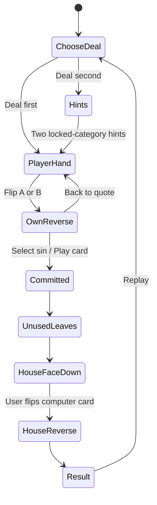

# Top Trumps — current game flows

2 November 2026 · Supersedes earlier hidden-player-score and automatic-house-flip descriptions.

## Deal first

1. Player presses Deal first.
2. Server locks three distinct cards; two appear quote-side up on the baize.
3. Player presses Flip card A/B to rotate a card to its six sins and scores. Both may be inspected and flipped back without committing.
4. Player taps one sin row on the chosen reverse. That card/category commits; input is disabled during submission.
5. Server stores the original result exactly once.
6. Unused player card slides off; selected card stays in its original slot, score-side up.
7. Computer's face-down house card enters the vacated slot and **waits**.
8. Player presses Flip computer's card.
9. Computer turns to its six sins/scores. The selected sin highlights on both reverses, outcome and scores appear, then replay offers Deal first or Deal second.

## Deal second

1. Player presses Deal second.
2. Server locks three distinct cards and a computer category. Current default randomly chooses one of the computer card's top two, using stable deck order to break ranking ties.
3. Show both top-category names, without rank, chosen category or computer scores. Deal two player quote cards.
4. Player flips either/both and inspects their own six scores.
5. Player presses Play card A/B on the chosen reverse. They do not choose a category. Server resolves using its previously locked category.
6. Remove the unused card, replace it with the face-down house card, then wait for the user's Flip computer's card action.
7. Reveal sins/scores and the locked deciding category; higher wins, equal draws. Offer either replay mode.

## Reveal and disclosure matrix

| Stage | Player's quote | Player's six scores | Computer hints | Computer identity/scores | Outcome |
|---|---|---|---|---|---|
| Own front | Visible | Included in dealt-card payload; hidden visually | Deal second only | Absent from precommit payload | Absent |
| Own reverse | Front available by flip | Visible | Deal second only | Absent | Absent |
| Committed / house face down | Available | Visible | Previously shown hints | Returned by reference API but visually hidden | Stored; visually hidden |
| User flips house | Available in details | Visible | No longer needed | Visible | Visible |

Only the player's own scores may be inspected before committing. The manual house reveal in this prototype is a visual interaction after server resolution. A stricter delayed-data reveal requires a separate server reveal action, as described in SOLUTION_DESIGN.md.

## Edge cases and acceptance checks

- Flip A, flip B, return to A: no mutation of the server deal or chosen computer category.
- A/B must be distinct from one another and from the computer, and HOLD cards never dealt.
- Playing A leaves A in its slot; playing B leaves B in its slot. The computer always uses the unused slot.
- Sin rows are actionable only in Deal first. Deal second offers a card-play button instead.
- Duplicate commits return the first result, even if retried with a different card/category.
- House does not auto-flip, including in reduced-motion mode. No outcome, deciding-category highlight or totals update before the manual flip.
- Keyboard users can flip/play with native buttons; inactive faces are inert and hidden from accessibility tools.
- Reduced-motion users get the same step order without sliding/rotation delays.
- Both card shells have equal width and height at a given breakpoint. Long text remains readable with internal scroll.
- Refresh: same committed result restored; current reference intentionally presents the house face down again. Totals are page-local.
- Network error: show an error and preserve the deal. Do not deal a substitute opponent.
