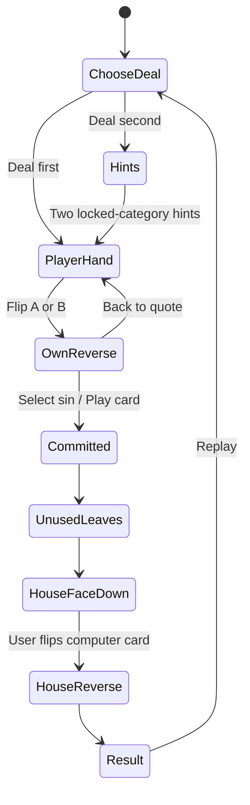

# Top Trumps — current game flows

**New human flow, specification only:** [ASYNC_CHALLENGES.md](ASYNC_CHALLENGES.md). This is a saved send-and-respond-later challenge, not a live room. Earlier computer/reference flows remain separate and later UI updates take precedence over the original prototype wording.

2 November 2026 · Supersedes earlier hidden-player-score and automatic-house-flip descriptions.

## Deal first

1. Player presses Deal first.
2. Server locks three distinct cards; two appear quote-side up on the baize.
3. Player flips their card to its six sins and scores. It may be flipped back without committing.
4. Player taps one sin row on the chosen reverse. That card/category commits; input is disabled during submission.
5. Server stores the original result exactly once.
6. Unused player card slides off; selected card stays in its original slot, score-side up.
7. Computer's face-down house card enters the vacated slot and **waits**.
8. Player presses Flip computer's card.
9. Computer turns to its six sins/scores. The selected sin highlights on both reverses, outcome and scores appear, then replay offers Deal first or Deal second.

## Deal second

1. Player presses Deal second.
2. Server locks two distinct cards (player and computer) and a computer category. Current default randomly chooses one of the computer card's top two, using stable deck order to break ranking ties.
3. Show both top-category names, without rank, chosen category or computer scores. Deal one player quote card.
4. Player flips their card and inspects its six scores.
5. Player presses Play on their card's reverse. They do not choose a category. Server resolves using its previously locked category.
6. Place the face-down house card beside the player's card, then wait for the user's Flip computer's card action.
7. Reveal sins/scores and the locked deciding category; higher wins, equal draws. Offer either replay mode.

## Reveal and disclosure matrix

| Stage | Player's quote | Player's six scores | Computer hints | Computer identity/scores | Outcome |
|---|---|---|---|---|---|
| Own front | Visible | Included in dealt-card payload; hidden visually | Deal second only | Absent from precommit payload | Absent |
| Own reverse | Front available by flip | Visible | Deal second only | Absent | Absent |
| Committed / house face down | Available | Visible | Previously shown hints | Returned by reference API but visually hidden | Stored; visually hidden |
| User flips house | Available in details | Visible | No longer needed | Visible | Visible |

Only the player's own scores may be inspected before committing. The manual house reveal in this prototype is a visual interaction after server resolution. A stricter delayed-data reveal requires a separate server reveal action, as described in SOLUTION_DESIGN.md.

## Edge cases and acceptance checks

- Flip A, flip B, return to A: no mutation of the server deal or chosen computer category.
- A/B must be distinct from one another and from the computer, and HOLD cards never dealt.
- Playing A leaves A in its slot; playing B leaves B in its slot. The computer always uses the unused slot.
- Sin rows are actionable only in Deal first. Deal second offers a card-play button instead.
- Duplicate commits return the first result, even if retried with a different card/category.
- House does not auto-flip, including in reduced-motion mode. No outcome, deciding-category highlight or totals update before the manual flip.
- Keyboard users can flip/play with native buttons; inactive faces are inert and hidden from accessibility tools.
- Reduced-motion users get the same step order without sliding/rotation delays.
- Both card shells have equal width and height at a given breakpoint. Long text remains readable with internal scroll.
- Refresh: same committed result restored; current reference intentionally presents the house face down again. Totals are page-local.
- Network error: show an error and preserve the deal. Do not deal a substitute opponent.

## Computer quote and result alignment update — 2 November 2026

After commitment, the computer's card enters the unused slot showing its illustrated quote front, not an anonymous house cover. The user then flips that quote card to reveal its six sins/scores and the result. Precommit responses still omit all opponent data; committed responses include only `opponentFront` (ID, label, quote, speaker), without scores, rationale, locked category or outcome. The reveal action delivers scores/result. This supersedes older descriptions that conceal the computer's identity until the flip itself.

Each revealed score is rendered directly beneath the card it belongs to, in the same slot/container. When the computer is on the left its score is on the left. In the stacked mobile layout, each score follows its own card rather than appearing in a separately ordered summary. The separate summary displays only the deciding sin and outcome.

Deal second prompt explicitly labels the two names as possible sins, with one already locked. Neither is presented as the selected sin. The commit/reveal sequence always compares the locked sin, including after restore or a client supplying a different category.

## Asynchronous friend challenge flow

1. Sender creates a saved draft, reads/flips their card, selects a sin and explicitly locks the challenge.
2. Sender taps Share invitation, chooses WhatsApp, Messages/SMS, email or another available share target and confirms sending. Copy link is the fallback. Closing sharing preserves the draft/locked invitation; the game cannot assert delivery.
3. Sender can close the browser. The recipient later opens the invitation, validates it and explicitly accepts; previewing a link does not claim a seat.
4. Recipient inspects their own reserved card and all six scores. The Play for panel shows the locked chosen sin mixed with one decoy. They submit their card without choosing a sin.
5. Server records one immutable result. Recipient sees the sender's quote front and flips it to reveal scores, winning-green row, tally and celebration.
6. Sender returns later to Result ready, reads the recipient's quote and explicitly reveals their view of that same result. No paid or automatic WhatsApp/SMS alert is assumed; recipient may manually Share reply.
7. Challenge back creates a new independent draft with roles reversed. The original challenge and its result remain unchanged.

Read [the full specification](ASYNC_CHALLENGES.md) for expiry/cancel/decline paths, simultaneous claims/responses, recovery, disclosure and device tests. The seven-day deadline, 30-day result retention and one-card-per-human format are proposed defaults.
