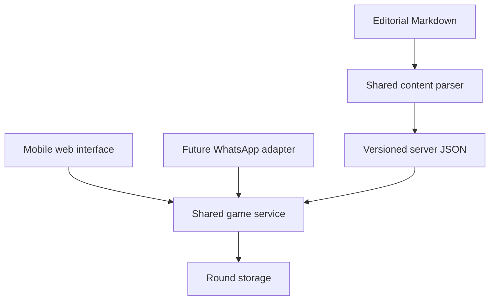

# Top Trumps — solution design and independent developer handoff

Version 2.0 · 2 November 2026 · Current owner-approved web interaction

## Start here

Read [REQUIREMENTS.md](REQUIREMENTS.md) for product scope, [GAME_FLOWS.md](GAME_FLOWS.md) for the precise interaction, and [ARTWORK.md](ARTWORK.md) for the visual assets. The current private reference is https://toptrumps-play.debagged.chatgpt.site. It requires the owner's ChatGPT sign-in; an independent implementation must not require access to that Site to understand or reproduce the design.

The canonical editorial source is `docs/DONALD_DECK_CANDIDATES.md`; generate `content/server/donald.json` with `python3 scripts/build_content.py`. Use `scripts/card_content.py` as the shared parser. Optional Supabase files remain historical/future exports. Supabase and Brevo are not dependencies of web gameplay.

## Architecture

Web and a future chat adapter must call the same deal, inspect/flip, commit, resolve and replay services. Animation is presentation; it must never calculate outcomes or change random selection. No live LLM is needed.

The current prototype is React with Vinext/Next-style routes on a Cloudflare Worker. Cloudflare D1 stores round state, not card content. These are reference choices, not mandatory infrastructure. Another backend/framework can implement the same contracts. The data adapter currently uses `cloudflare:workers`; replace it when deploying elsewhere. A database capable of atomic conditional updates is appropriate for independent durable round state.

## Rules and deterministic choices

1. Configure category order from the deck: Pride, Greed, Lust, Envy, Wrath, Stupidity. Greed absorbs Gluttony; Stupidity replaces Sloth.
2. Uniformly draw three distinct eligible cards without replacement using server-side secure random selection. Two belong to the player; one to the computer. Lock all three before any choice. The reference excludes eight HOLD cards but otherwise uses draft candidates for private testing only.
3. Deal first: the player flips either/both cards, sees all of their scores, then selects a category row on one reverse. This commits that card and category immediately.
4. Deal second: rank the computer's six categories descending by score; ties use deck category order. Take the first two. Reference default: randomly choose one of those two and lock it before player choice. Show the two hint names in deck order, without relative rank, selected category, computer identity or scores. The player inspects either/both cards and presses Play card A/B on one reverse. The locked computer category controls resolution; ignore any player-supplied category in this mode.
5. Resolve once: higher selected-category score wins; lower loses; equal draws. The server persists the result before any animation.
6. Presentation then removes the unused card, places a face-down house card in that exact slot, and waits. Only the user's Flip computer's card action turns the house card to its sins/scores and displays the outcome.
7. Replay offers either deal mode. Never overwrite an unresolved round merely because a deal request is repeated.

The computer's random top-two choice and tie handling are explicit prototype defaults. Do not silently replace them with selecting a best counter-card or adapting to the user's chosen category.

## State and version model

Recommended production records:

- Round: opaque random ID, browser/player owner, mode, state/version, two player card-version snapshots, locked opponent snapshot, locked computer category, two hints, chosen player card/category, final scores/outcome, created/committed/revealed timestamps and expiry.
- Snapshot: stable card ID, content version, exact quote, speaker/context, six scores/rationales, artwork reference and source links.
- Session: opaque server-issued identity or authenticated player identity; entitlements when commerce is added.

Pin complete content snapshots or immutable content-version references at deal time. Later editorial deployment must not change an existing round. The reference prototype stores IDs and resolves against its bundled content, so version pinning is a known gap to fix, not completed functionality.

Server lifecycle: `dealt -> committed/resolved -> revealed`, with optional `expired/abandoned`. Resolve in one transaction or compare-and-set. Presentation lifecycle: `front <-> own reverse -> unused card departing -> house entering -> awaiting user flip -> house turning -> result`.

The current prototype has no separate durable revealed field; refresh of a resolved round returns its house card face down. Independent implementation may preserve revealed state explicitly. Do not confuse a client animation phase with durable game state.

## Reference API

`GET /api/game` restores the cookie's round, or null. All game responses use `Cache-Control: no-store`.

`POST /api/game` with `{action:"deal",mode:"first"|"second"}` returns two player cards, category definitions, mode and (second only) two hint names. Each player card now intentionally includes its own six scores so the reverse can display them. Never include the opponent ID/quote/scores or locked computer category before commitment.

`POST /api/game` with `{action:"play",card:<dealt player card ID>,category:<name>}` commits Deal first. Deal second uses `{action:"play",card:<ID>}`; the server uses its previously locked category. Reject non-dealt cards and invalid categories; repeated commit returns the original result. The reference route is in `reference/prototype/app/api/game/route.ts`.

After commitment, the reference response includes `result`, `played` and `opponent`; the UI keeps the opponent face down until clicked. **This manual reveal is a presentation reveal, not network secrecy after commitment.** If the independent product requires scores to remain network-inaccessible until the flip itself, return a pending result token at commit and introduce a server reveal endpoint. Do not claim the reference already does this.

Current cookie: `tt_round`, a random UUID, HttpOnly, SameSite=Lax, Secure on HTTPS, 24-hour browser lifetime. Cookie expiry is not server-side retention cleanup. Production needs proper session ownership and server expiry enforcement. Do not copy an active Site identity, credential or deployment manifest into a different host.

## UI and animation contract

- Green felt baize, wood/gold rim, ivory quote fronts, midnight-blue/gold score reverses. See the committed original portrait.
- Identical 640px-tall reference shells; two columns on desktop, stacked below 560px. Long quotes scroll within the same fixed card instead of shrinking text or changing its height.
- Player flip is a 3D Y rotation (~720ms), with separate front and reverse. Use native buttons; inert/aria-hidden must remove the inactive side from keyboard and screen-reader navigation.
- Deal first reverse: six selectable sin rows with visible scores and arrows; each commits the containing card. Deal second reverse: six score rows plus Play card A/B; no player category choice.
- Keep the selected card in its original A/B slot. Slide the other off-table (~550ms), slide the house cover into that slot (~650ms), then stop. Its only available action is Flip computer's card.
- User flip rotates house cover to score reverse (~750ms). Highlight the deciding category on both cards and show scores/outcome/replay only after the flip. Do not leak outcome through heading, totals or highlight while waiting.
- Respect prefers-reduced-motion: skip timing/motion but still require the manual house flip. Prevent interaction while committing/transitions are in progress. An error must leave the game recoverable, never silently reroll.
- Reference totals count the current page visit only. Accounts, persistent totals, purchases and WhatsApp are not implemented.

## Reference source map

`reference/prototype/` is a readable snapshot of the deployed UI/API/test files, not a complete installation of the Sites runtime. It includes page/layout/CSS, server route, D1 schema/migration, game tests and package metadata. The JSON import in the route expects `<application-root>/data/donald.json`; materialize that from the canonical generated JSON rather than maintaining another editorial source. Copy `assets/artwork/donald-portrait.png` to `<application-root>/public/trump-art.png` or adjust the page's URL. Do not add scores to client components beyond the player's two dealt cards and the resolved comparison.

Independent setup:

1. Choose your React host (or equivalent UI) and backend; scaffold outside the editorial root or under a new application directory.
2. Port the reference UI/CSS and use the committed artwork. Preserve the semantic behavior, not provider-specific scaffolding.
3. Implement a round-store adapter for the chosen database. D1 SQL is provided as a minimal reference. Implement content snapshots, ownership and expiry before public use.
4. Import generated JSON only in server code. Expose an explicit player-card projection. Share rule logic with future adapters.
5. Run the equivalent game and UI acceptance tests, then deploy to your chosen host. No private ChatGPT Site token, paid Brevo WhatsApp plan or Supabase project is required to start.

## Verification and remaining work

The snapshot passed TypeScript and build checks, 50 automated rounds, and browser checks for both modes, manual card reversal, fixed card sizes and result restoration. The test uses an in-memory D1-shaped adapter: it does not prove real database concurrency or browser animation timing.

Before public release: source verification/editorial approval and publication gating; immutable round snapshots; enforced expiry and retention cleanup; rate limits; ownership checks; explicit action validation and robust concurrent deal idempotency; accessible focus handling and real narrow-screen testing; durable statistics; operational recovery. Accounts/commerce/WhatsApp remain separate delivery stages.

The original scope's accounts, entitlements, payment verification and cross-channel rules remain requirements when those features are built. They are not dependencies for this private web playtest.

## Standalone AWS implementation update (v2.1)

The current runnable code is `web/`; the preceding `reference/prototype/` discussion describes the historical Site snapshot. See [AWS_DEPLOYMENT.md](AWS_DEPLOYMENT.md) and `web/README.md` for current deployment steps.

- Standard Next.js 15 and React, deployed through root `amplify.yml` with app root `web`.
- Canonical content/artwork copied during preparation; no duplicated editorial dataset or additional raster source.
- Pure shared rules in `web/lib/game.mjs`, transition service in `web/lib/service.mjs`, DynamoDB adapter in `web/lib/store.mjs`.
- Each stored session has an opaque 256-bit ID, revision, immutable round snapshot and enforced 24-hour expiry. DynamoDB conditional PutItem provides compare-and-set; TTL removes expired entries asynchronously.
- POST actions are `deal`, `play`, `reveal`. Before reveal, the response includes neither opponent data nor result. Commitment returns `committed: true`, `done: false`, `playedCardId` and the player's own fields. Reveal changes `done` to true and returns the original result and opponent. GET restores that durable stage.
- A same-site HttpOnly cookie identifies the session. Origin checks reject cross-origin writes when an Origin header is present. HTTPS uses Secure cookies. Requests are size-limited and actions explicitly validated.
- AWS SSR compute role grants only GetItem/PutItem for the dedicated rounds table; no long-lived AWS credentials are written into app files. The deploy helper merges the main branch's existing variables and refuses apps linked to another repository.

The old prototype's network-secrecy, snapshot and concurrency gaps are addressed by this implementation and unit tests. Real AWS integration/device validation and public-launch editorial/operational work still require completion. No AWS deployment has been claimed without authenticated execution.

## Computer quote and result alignment update — 2 November 2026

After commitment, the computer's card enters the unused slot showing its illustrated quote front, not an anonymous house cover. The user then flips that quote card to reveal its six sins/scores and the result. Precommit responses still omit all opponent data; committed responses include only `opponentFront` (ID, label, quote, speaker), without scores, rationale, locked category or outcome. The reveal action delivers scores/result. This supersedes older descriptions that conceal the computer's identity until the flip itself.

Each revealed score is rendered directly beneath the card it belongs to, in the same slot/container. When the computer is on the left its score is on the left. In the stacked mobile layout, each score follows its own card rather than appearing in a separately ordered summary. The separate summary displays only the deciding sin and outcome.

Deal second prompt explicitly labels the two names as possible sins, with one already locked. Neither is presented as the selected sin. The commit/reveal sequence always compares the locked sin, including after restore or a client supplying a different category.
